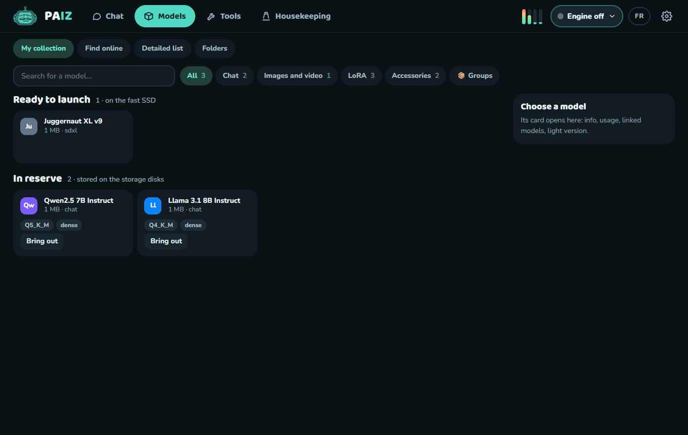

# PAIZ — faire tourner des modèles d'IA « trop gros » sur la machine que tu as

*La présentation complète est en anglais : [README.md](README.md).*

PAIZ est un atelier d'IA local construit autour d'un moteur qui **streame les experts des modèles MoE** (Mixture-of-Experts)
du SSD vers la RAM puis la VRAM. Il fait tourner des modèles normalement trop lourds pour la carte graphique et la mémoire
(un modèle de 48 Go sur une carte de 12 Go avec 32 Go de RAM), au prix de la vitesse.

C'est **lent par principe** : le but n'est pas de battre llama.cpp, mais de pouvoir utiliser de plus gros modèles. L'idée est
de confier de **longues tâches de fond** à un modèle lourd qui travaille directement dans le dossier d'un projet, pendant
qu'on discute et qu'on planifie avec un modèle léger.

- Testé surtout avec **Qwen3-Coder-Next (48,5 Go)** et **Gemma 4 26B-A4B (16 Go)**, sur une seule machine
  (Windows 11, RTX 3060 12 Go, 32 Go de RAM, SSD NVMe).
- **Modes mémoire** (Discret, Léger, Sobre, Vif, Rapide) : même texte, plus ou moins de RAM et de VRAM. **Versions légères**
  (requantification Q3/Q2) pour regagner de la vitesse, avec perte, toujours signalées.
- **Tâches** : file d'attente, brouillons proposés par l'assistant, dossier de travail et fichiers à reprendre, vitesse du
  modèle de tâche réglable.
- **Modèles gratuits d'OpenCode** en renfort des modèles locaux, et **mode sans fenêtre** (API compatible OpenAI) pour
  OpenCode ou n'importe quel client.
- **Collection de modèles** : étagères « prêts à lancer » / « réserve » (parking), rangement propre avec `CATALOGUE.md`,
  doublons, fusion de dossiers, ménage. **Groupes de modèles** : ranger / rappeler d'un coup tous les modèles d'un projet, chacun à son adresse exacte ; un modèle peut-être partagé n'est jamais déplacé sans ton accord.
- **Second moteur (expérimental)** : llama.cpp récent, choisi par architecture (aujourd'hui Inkling 2 Mini) ; Gemma/Qwen gardent le moteur WeightStream.

Limites principales : **SSD obligatoire** (NVMe recommandé) pour les modèles qu'on lance, car le moteur lit les experts
dans le fichier pendant la génération ; un disque dur ou une clé USB ne sert qu'à la réserve. Modèles MoE seulement, lecture des longs prompts lente (~50 jetons/s), Windows + NVIDIA uniquement,
mesuré sur une seule machine.

Licence : code sous Apache 2.0 ([LICENSE](LICENSE)) ; les illustrations ne sont pas couvertes ([NOTICE](NOTICE)).

## Installation (Windows)

Télécharge `PAIZ-WeightStream_x.y.z_x64-setup.exe` sur la page [Releases](https://github.com/Nosferatumiamor/PAIZ/releases) et lance-le (pas besoin d'être administrateur). Il faut une **carte NVIDIA avec un pilote récent** (CUDA 12) et un **SSD**.

> **« Windows a protégé votre PC » (SmartScreen) : c'est normal, l'installateur est sûr.** PAIZ est un jeune projet open source et l'installateur n'est **pas signé** (un certificat de signature coûte cher chaque année) : Windows prévient pour tout programme non signé qu'il n'a pas vu très souvent. Ça ne veut pas dire qu'un virus a été trouvé. Clique sur **Informations complémentaires → Exécuter quand même**. Tout le code est dans ce dépôt si tu préfères le compiler toi-même. La désinstallation (Paramètres → Applications) retire le programme, ses raccourcis et ses entrées de registre ; une case permet d'effacer aussi les données de PAIZ (`%APPDATA%\PAIZ`), conservées par défaut.
