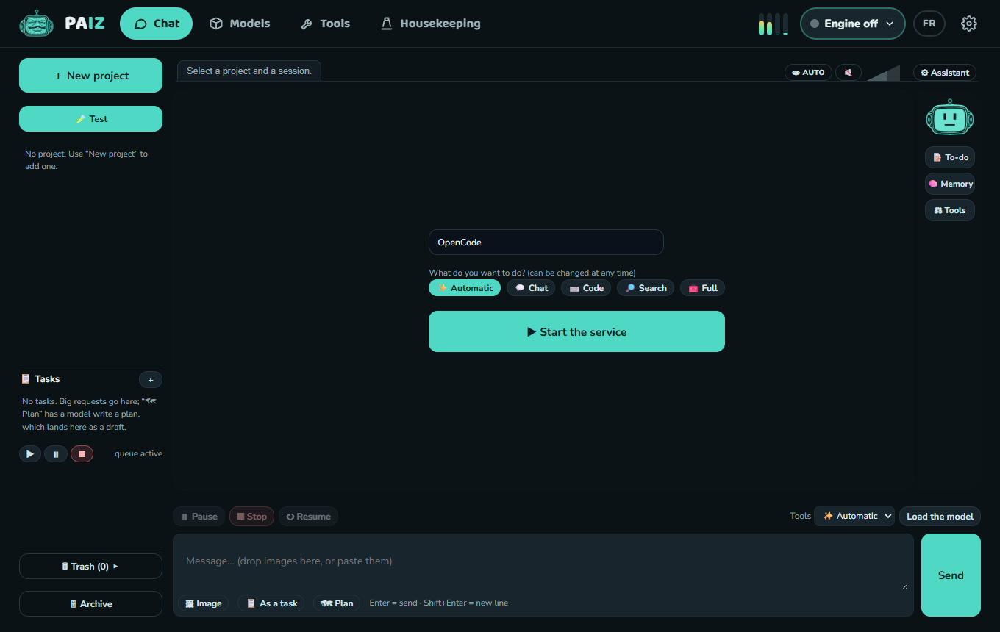
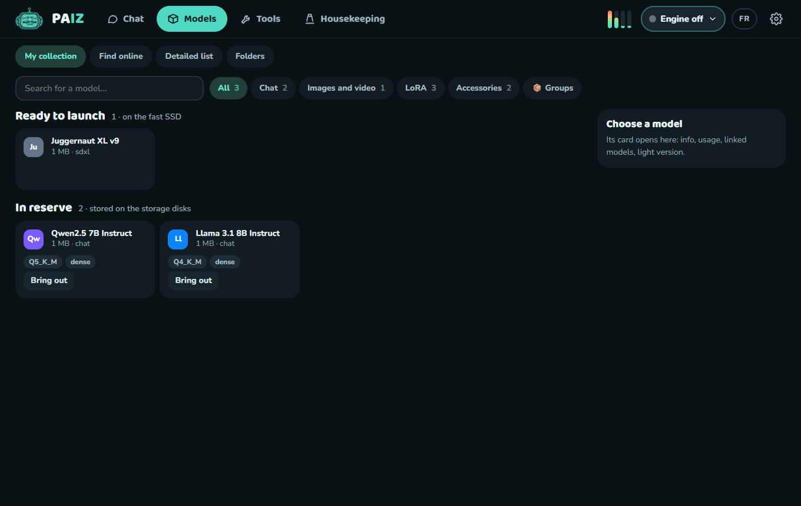
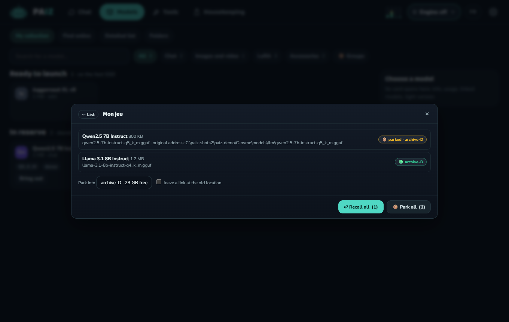
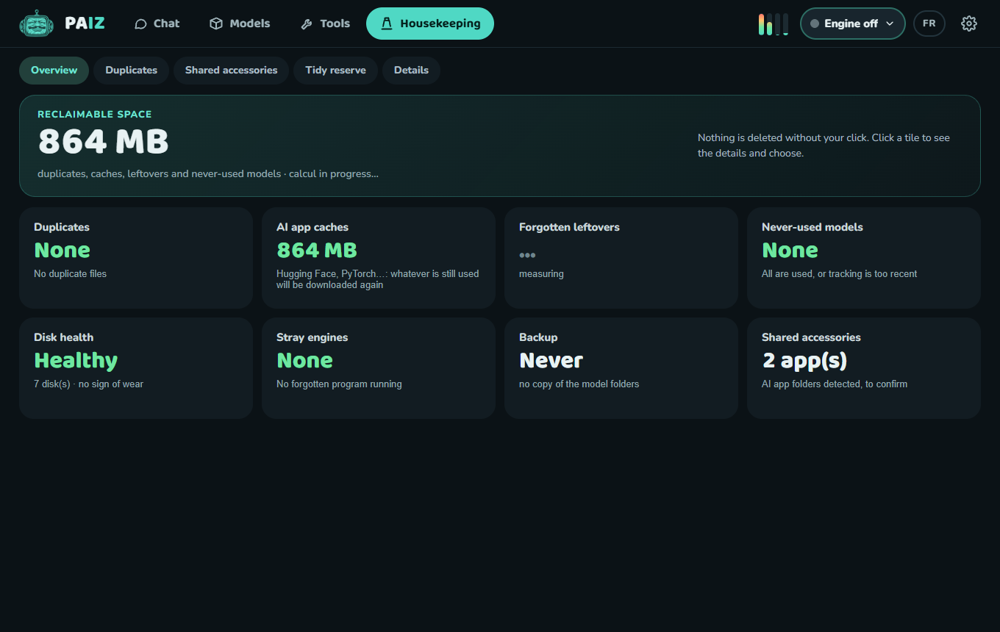

<p align="center"></p>

# PAIZ — run "too big" AI models on the machine you have

**PAIZ is a local AI workbench built around a weight-streaming engine.** It runs Mixture-of-Experts (MoE) language models
that are normally too heavy for your graphics card and RAM — a 48 GB model on a 12 GB GPU with 32 GB of RAM — by streaming
their experts from the SSD as they are needed.

It is **slow by design**. PAIZ is not a race against llama.cpp: it trades speed for the ability to use bigger, smarter
models at all. The idea is to let a heavy model **work slowly in the background on your projects** (long coding or
writing tasks), while you keep chatting and planning with a light, fast model.

*Version française courte : [README.fr.md](README.fr.md).*

| | |
|---|---|
|  |  |
|  |  |

*Screenshots taken on a demo library with fake files (`npm run demo` in `app/`, then `node scripts/screenshots.mjs`).*

> Status: early public version, tested on one machine (Windows 11, RTX 3060 12 GB, 32 GB RAM, NVMe SSD).
> Mainly tested with **Qwen3-Coder-Next (48.5 GB)** and **Gemma 4 26B-A4B (16 GB)**.

---

## The idea in one paragraph

A MoE model is made of many small "experts", and only a few of them are used for each word: Gemma 4 26B has 128 experts per
layer and uses 8. PAIZ's engine — llama.cpp with streaming hooks — keeps only the experts it needs in a VRAM cache and a RAM
cache, and reads the rest from the SSD when they are asked for. The model file stays on disk; what lives in memory is a
working set you choose, from a few hundred MB to "use the whole machine". By default the output is **identical** to
llama.cpp's (lossless); lossy options exist and are labelled as such.

## What has been measured

One machine: RTX 3060 12 GB, 32 GB RAM, NVMe SSD, Windows 11. Output identical to llama.cpp unless stated.

| Use case | Model | Memory used | Speed |
|---|---|---|---|
| Tiny footprint (chat, game NPC) | LFM2-8B-A1B (5 GB) | RAM 0.8 GB · VRAM 0.6 GB | 2.2 tokens/s |
| Mid-size model, capped | Gemma 4 26B-A4B Q4 (16 GB) | VRAM 4 GB · RAM 4.5 GB | 9.8 tokens/s |
| Mid-size model, comfortable | Gemma 4 26B-A4B Q4 | VRAM 6 GB · RAM 8 GB | 19.6 tokens/s |
| Bigger than the machine | Qwen3-Coder-Next (48.5 GB) | VRAM 8 GB · RAM 7.6 GB | 4.6 – 5.9 tokens/s |
| Much bigger than the machine | GLM-4.5-Air (68 GB) | under a RAM cap | 0.6 – 0.8 tokens/s (4–5× llama.cpp under the same cap) |

Full measurement log: [`engine/Docs/USAGES.md`](engine/Docs/USAGES.md) and [`engine/Docs/HANDOFF_2026-11.md`](engine/Docs/HANDOFF_2026-11.md).

## Limits — read this before you rely on it

- **An SSD is mandatory (NVMe strongly recommended).** The engine reads experts from the model file while it generates, so
  the model must sit on an SSD. On a hard disk (HDD) or a slow USB drive, streaming is far too slow to be usable: keep those
  disks for *Reserve* (parked models) only, and launch from a *Ready* folder on the SSD.
- **MoE models only.** Dense models (most older small models, image diffusion models) use all their weights for every word:
  there is nothing to stream. PAIZ still launches them, but cannot make them lighter. Each model shows a **MoE** / **dense** badge.
- **Reading long prompts is slow.** Prompt processing runs at about 50 tokens/s, against ~260 for stock llama.cpp on the same
  machine. A coding agent with a large prompt can wait a minute (several minutes on a 48 GB model) before the first word.
  This is the main known weakness, and the reason long jobs are meant to run as background tasks.
- **Tested on one machine.** Smaller and bigger machines should benefit the same way (more RAM = fewer SSD reads), but this
  has not been measured yet.
- **Windows + NVIDIA (CUDA) only** for now. The engine is built by hand (scripts below); there is no installer yet.
- **Lossy modes are opt-in** and always marked (see below).

## Features

### Speed vs. resources
- **Memory modes** — *Discreet* (leaves the GPU almost free), *Light*, *Lean*, *Lively*, *Fast* (large VRAM cache): the same
  model and the same text, with more or less RAM/VRAM given to the expert caches. Measured on Gemma 4 26B: from ≈ 5.8 tokens/s
  with 3.6 GB of VRAM to ≈ 43 tokens/s with 10 GB.
- **Lighter versions (quantization)** — PAIZ can re-quantize a model to Q3/Q2 to get some speed back. This **changes the
  text** (lossy): it is shown with an orange *light* badge and a "faster but less reliable" warning, and is never used unless
  you choose it.

- **Second engine for models our patched llama.cpp does not know yet (experimental)** — recent stock llama.cpp (`engine/scripts/fetch-stock-llama.ps1`),
  used automatically by architecture (today: Inkling 2 Mini, `inkling2_loop`); Gemma/Qwen keep the WeightStream engine and their modes.
  The modes map to a hard cap on the *working set* of the process, and VRAM stays low (`--cpu-moe --no-op-offload`). Measured on
  Inkling 2 Mini Q4 (16.6 GB): ≈ 3.3 GB of VRAM, ≈ 7 tokens/s with free RAM (the file is memory-mapped, 16.5 GB of reclaimable pages),
  ≈ 4 tokens/s capped at 8 GB, ≈ 3.5 capped at 4 GB. Reading a long prompt is done by the CPU (≈ 15–18 tokens/s). One run per
  setting, one machine. **Caveat:** under such a cap Windows keeps the trimmed pages in its file cache (we measured only 68 MB read
  from the SSD during a whole generation at 4 GB), so the slowdown is page-fault overhead, not SSD streaming, and the system RAM
  is not really freed unless other programs need it (the cache is then given back). It does not emulate a machine that truly has 4 GB.

### Long tasks for the heavy model, chat with the light one
- A **task queue** next to the chat: hand a long job to a heavy "workhorse" model (e.g. Qwen3-Coder-Next 48 GB) that runs on
  a second engine, while you keep talking to a light model.
- A task **works directly in a project folder** (through an OpenCode session with tools): it reads the files you give it,
  improves them in place, then summarises what it changed. Without a folder, it simply returns text.
- **Drafts**: the assistant knows PAIZ's tools and can propose a task in the chat; one click turns it into a draft you review,
  edit (destination folder, files to work on, model, speed of the workhorse) and launch. A "Plan" button has a model write the
  plan of a task first.
- To-do notes per project, long-term memory, characters (faces and voices you can freely mix), retro dialogue sounds, and an
  "eye" that describes images for models that cannot see.

### OpenCode, local or free cloud
- The chat and the tasks are driven by [OpenCode](https://opencode.ai) on the local model.
- **OpenCode Free Cloud Models** can back up the local ones, for a chat session or a task, with a privacy badge per model
  (data retained / used, or zero retention announced). No account or payment is ever connected: only the free public tier.
- **Headless**: PAIZ also serves an OpenAI-compatible API, so OpenCode (or Continue, Open WebUI, Cline, scripts…) can use the
  local model without the PAIZ window at all — see below.

### Model collection, sorting and parking
- **Two shelves**: *Ready* folders on a fast SSD (the models you run) and *Reserve* folders on storage disks (parked models).
  Launching a parked model brings it out first; "store" puts it back. Copies are verified, progress is shown live.
- **Model groups** (📦 *Groups*): name the models of a project (e.g. a character's pack), park them all in a Reserve folder in
  one click and recall them all in one click — each file goes back to its exact original address, even when they came from
  different folders. A model that may be shared (in another group, linked for another app, or inside LM Studio / Ollama /
  Hugging Face folders) is never moved without your explicit confirmation; an optional symlink can be left at the old place.
- **Clean stable**: sort a messy model folder into `LLM/<family>/<model>`, `Images/<type>/<base>`, `Video/…`, with a
  `CATALOGUE.md` that PAIZ keeps up to date (your notes in it are read back). Every reorganisation can be undone.
- **Duplicates** merged safely (hard links on the same disk, content compared first, never the last copy), folders merged into
  one another, shared accessories (text encoders, VAEs) explained: what each one is for, and whether any model still needs it.
- **Housekeeping**: reclaimable space, AI app caches, leftovers, disk health, stray engine processes, backups.
- **Tools**: MCP servers (Blender, ComfyUI, Godot, web search…) and skills, from a catalogue; only the servers a question
  needs are offered to the model, to keep prompts short.

## Install (Windows installer)

Download `PAIZ-WeightStream_x.y.z_x64-setup.exe` from the [Releases](https://github.com/Nosferatumiamor/PAIZ/releases) page
and run it (no administrator rights needed). It contains the application, the Node runtime, the compiled engine and the CUDA
runtime: you only need an **NVIDIA GPU with a recent driver** (CUDA 12) and an **SSD**.

> **"Windows protected your PC" (SmartScreen) — this is expected, the installer is safe to run.**
> PAIZ is a young open-source project and the installer is **not code-signed** (a signing certificate costs money every
> year), so Windows warns about every unsigned program it has not seen many times. It does not mean a virus was found.
> Click **More info → Run anyway**. If you prefer not to trust a binary, the whole source is in this repository and you can
> build it yourself (see *Build from source* below); the Releases page lists the file's size so you can check you got the
> right one. The installer needs no administrator rights, installs for your user only, and the uninstaller (Settings →
> Apps) removes the program, its shortcuts and its registry entries; a box lets you also erase PAIZ's data
> (`%APPDATA%\PAIZ`: catalogue, conversations, memory), which is kept by default.

On first launch, a setup assistant asks for:
1. the **Ready** folder for the models you run — on an SSD (it lists your disks and tells SSDs from hard disks);
2. the **Reserve** ("stable") folder for parked models — any disk with room;
3. **OpenCode Desktop** (used by the chat and the tasks) — it downloads and opens the official installer if it is missing;
4. **first models** from Hugging Face: Gemma 4 26B-A4B Q4_K_M (17 GB, recommended) and, optionally, Qwen3-Coder-Next
   Q4_K_M (48.5 GB, for slow background tasks; 32 GB of RAM recommended).

The assistant can be reopened later from **Models › Folders**.

## Build from source

Requirements: Windows 10/11, an NVIDIA GPU with CUDA 12, Node.js ≥ 24, Rust (for the desktop window), Visual Studio 2019/2022
Build Tools (for the engine), [OpenCode](https://opencode.ai) (for chat and tasks), and an **SSD (NVMe recommended)** to run
GGUF models from — mandatory, see *Limits*.

```powershell
git clone --recursive https://github.com/Nosferatumiamor/PAIZ.git    # or: git submodule update --init

# 1. the engine (once, ~20–30 min the first time)
cd PAIZ\engine
.\scripts\apply-llama-patch.ps1    # streaming hooks into third_party/llama.cpp
.\scripts\build-llama.ps1          # llama.cpp + CUDA -> engine\build-llama\
.\scripts\build-ws-tools.ps1       # ws_npc_server and tools -> engine\build-llama\bin

# 2. the application
cd ..\app
npm install
npm run tauri:build:exe            # desktop app: app\src-tauri\target\release\PAIZ-WeightStream.exe
..\PAIZ.bat                        # launch it
npm run tauri:installer            # or build the Windows installer (engine + CUDA runtime included) -> src-tauri\target\release\bundle\nsis\
```

### Headless (no window) — for OpenCode or any OpenAI-compatible client

```powershell
PAIZ-server.bat                              # reloads the last model if "Launch when PAIZ starts" is on
PAIZ-server.bat --model gemma                # load this model (name or id: node app\src\cli.js list --category llm)
PAIZ-server.bat --model gemma --mode leger   # with a memory mode
```

It prints the API address, loads the model and serves until Ctrl+C. Point any OpenAI-compatible client at
`http://127.0.0.1:7788/v1` (model name `local`, any API key). Do not run it at the same time as the desktop app.
Everything listens on 127.0.0.1 only, and the management API refuses requests coming from other websites.

### Tests

```powershell
cd PAIZ\app ; npm test
```

## Repository layout

```
PAIZ/
  app/      the application (Node ≥ 24, no runtime npm dependency; Tauri/Rust for the desktop window)
  engine/   the C++/CUDA engine, its ws_* tools, build scripts and measurement docs
            engine/third_party/llama.cpp = git submodule (pinned), hooks in engine/Docs/patches
  PAIZ.bat          launcher (desktop app)
  PAIZ-server.bat   server without a window (OpenAI-compatible API)
```

Models, conversations and personal data are never stored in the repository: application data lives in `%APPDATA%\PAIZ\data`.

## License

PAIZ's code is released under the **Apache License 2.0** ([LICENSE](LICENSE)). The artwork (logo, robot, character faces) is
**not** covered by it: see [NOTICE](NOTICE). llama.cpp is MIT-licensed. Models keep their own licenses.
